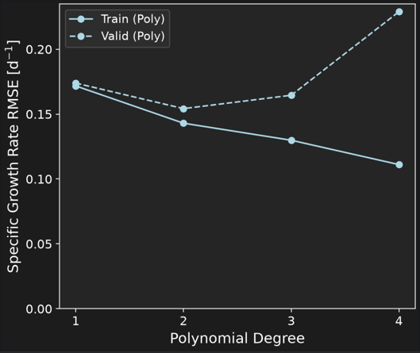
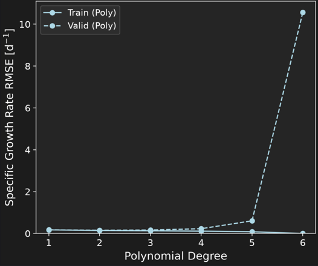
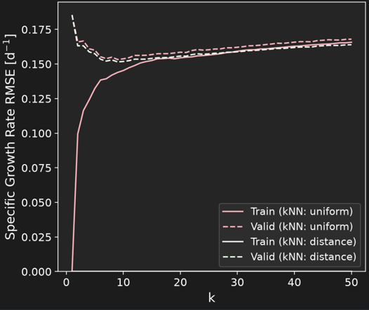
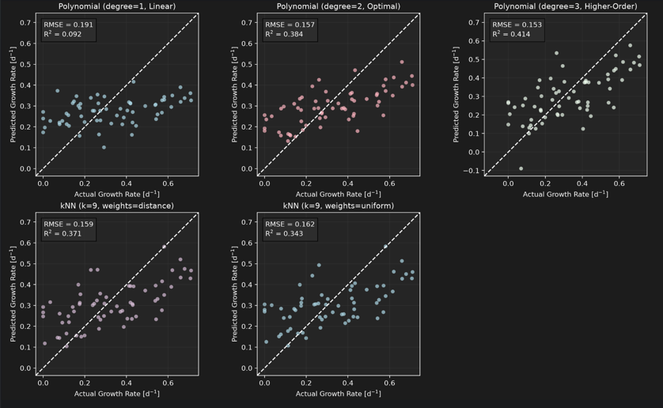

# Predicting Cell Growth Using Machine Learning

This project uses machine learning to predict specific cell growth rate ($d^{-1}$) from four 
bioprocess conditions such as temperature ($^\circ\text{C}$), pH, glucose concentration ($\text{mM}$), and lactate concentration ($\text{mM}$).
To do this, two regression approaches are used: **polynomial regression** and **k-nearest neighbors (kNN)**. 
The models are optimized using cross-validation, compared on an unseen test set, and used to visualize how predicted growth rate changes with each input variable. By accurately mapping bioprocess inputs to growth dynamics, this model provides a predictive tool to optimize bioreactor conditions, maximize biomass yield, and minimize expensive wet-lab experimentation.

---
## Highlights
- Engineered an object-oriented Python modeling pipeline for bioprocess analysis.
- Implemented K-fold cross-validation grid searches for hyperparameter tuning.
- Optimized feature scaling pipelines to ensure stable model convergence.
- Evaluated generalization performance on held-out test datasets.
- Visualized non-linear biological response curves and sensitivity plots.
---
## Environment
This project is built with Python and relies on standard data science and computing libraries. The specific software and library versions used in this project include:
- Python (v3.10.16)
- Matplotlib (v3.6.0)
- NumPy (v1.26.3)
- Pandas (v2.0.0)
- Scikit-Learn (v1.4.0)
---
## Code Design 

### Initialization (Running main.py)
When running main.py, the script initializes by defining the directory path to the experimental dataset and creating an object of CellGrowthModeler class. This class holds all configuration settings, such as train-test split ratios, random seed values, and cross-validation fold counts. The code is structured around an object-oriented approach so that the data handling, model training, evaluation metrics, and plotting functions are held within a single reusable class. This design keeps the main execution script clean and ensures that data pre-processing steps are applied consistently to both training and testing subsets without repeating code. The rest of the workflow can be broken down in 5 major steps, as described below. 

### Stage 1: Data Pre-Processing and Splitting
The first stage of the workflow uses Pandas to load the raw CSV dataset containing the bioprocess variables into memory. It automatically separates the input features, such as temperature, pH, glucose, and lactate, from the target variable, which is the specific cell growth rate. To prevent data leakage and ensure an honest evaluation of the models following this, the dataset is split into an 80% training set and a 20% test set using a fixed random seed for reproducibility. Additionally, summary statistics (e.g. means, standard deviations) and extreme growth conditions are also exported to CSV tables to give the user a baseline understanding of the dataset before any modeling starts. 

### Stage 2: Hyperparameter Optimization
The second stage focuses on finding the best model settings using 4-fold cross-validation via GridSearchCV. As previously mentioned, two regression models are used for this analysis. For Polynomial Regression, the script standardizes the input variables, generates polynomial and interaction terms, and fits a linear regression model. Polynomial degrees 1 through 6 are tested using four-fold cross-validation, with root mean squared error (RMSE) as the selection metric. For k-Nearest Neighbors (kNN) regression, the script standardizes the input variables before performing the regression. The search tests 1 to 50 neighbors with both uniform and distance-based weighting, also using four-fold cross-validation and the RMSE. These ranges help to find the right balance of model complexity for the data set. Finally, validation results are exported as tables and validation curves are plotted for both regressions to determine the optimal hyperparameters and identify underfitting/overfitting.

### Stage 3: Model Evaluation 
Once the optimal hyperparameters are identified, the selected polynomial and kNN configurations are fitted on the training set and evaluated using RMSE (where lower is better) and $R^2$ (where higher is better). This stage measures how well each model predicts data it hasn't seen before, the test set from Stage 1. It generates summary comparison tables and a multi-panel grid of actual versus predicted scatter plots, which makes it easy to visually verify how closely the predictions match experimentally measured growth rates.

### Stage 4: Learning Curves and Model Interpretation
Stage 4 looks at how training set size affects overall model performance by running our hyperparameter tuning pipeline on increasingly larger subsets of the data. By plotting training and validation errors as more samples are added, this stage helps diagnose whether our models suffer from high bias or high variance. It gives us a practical sense of whether gathering more experimental lab data would actually improve predictions or if the model has already hit a performance plateau due to inherent noise in biological systems.

### Stage 5: Model Interpretation and Sensitivity Analysis
The last stage converts the trained mathematical models back into interpretable biochemical units. It takes the standardized regression coefficients from the polynomial model fitted on the full dataset, showing which factors have the strongest linear and interactive effects on cell growth rate. It also generates sensitivity curves for each variable and holds the other three constant at their mean values to visualize how temperature, pH, glucose, and lactate drive growth rates relative to our experimental bounds.

---
## Results and Analysis

### Model Architecture and Hyperparameter Justification

Developing a robust machine learning workflow to predict specific cell growth rates (d-1) requires balancing model flexibility with performance. Biological systems have complex non-linear responses to environmental variables, meaning that a purely linear model is nto often able to accurately represent physiological dynamics. To address this, two distinct regression approaches, Polynomial Regression and k-Nearest Neighbors (kNN) Regression, were implemented, optimized, and evaluated across experimental datasets.

The dataset used to develop this model contains N = 318 bioprocess observations, measuring four primary features: temperature (ºC), pH, glucose concentration (mM), and lactate concentration (mM). Across the dataset, the specific growth rate has a mean of 0.2834 d-1 with a standard deviation of 0.1885 d-1, spanning from a minimum of 0.0 d-1 to a maximum of 0.750 d-1. Before training the model, all input features were standardized using standard scaling (zero mean and unit variance) to eliminate scale-related bias between the features and ensure every feature contributes equally to the distance calculations in kNN regressions.

For **Polynomial Regression**, hyperparameter tuning focused on identifying the **optimal polynomial degree** using 4-fold cross-validation via `GridSearchCV`. Degrees ranging from 1 through 6 were selected and evaluated, as degrees above 6 were observed to produce exponentially increasing RMSE. Degree 1 (linear model) yielded a validation root mean squared error (RMSE) of 0.17388. Expanding the feature space to Degree 2 introduced squared terms and pairwise interactions between the feautures, producing quadratic curvature and representing synergistic/combined effects between bioprocess variables. This reduced the validation RMSE to an optimal 0.15423 (± 0.01039). However, increasing further to Degree 3 increased validation RMSE slightly to 0.16452, while higher-order polynomials experienced catastrophic overfitting (shown in the figure below). Specifically, Degree 5 exhibited a validation RMSE of 0.60425, and Degree 6 greatly increased to a validation RMSE of 10.56776. Consequently, **Degree 2 Polynomial Regression** was selected as the optimal hyperparameter choice as it best represented the physical data (determined through RMSE) before resulting in extreme overfitting as we see in higher degrees.

**Figure 1. Validation Curve for Polynomial Regression Ranging From Degrees 1 through 4.** This result shows underfitting at degree of 1 (linear regression) and overfitting at degrees 3-4, highlighting degree 2 as the optimal choice. 

**Figure 2. Validation Curve for Polynomial Regression Ranging From Degrees 1 through 6.** This results shows the rapid increase in error, highlighting the effect of overfitting as the polynomial degree increases. 

For a non-parametric comparison, k-Nearest Neighbors (kNN) regression was tuned across neighborhood sizes k in [1, 50] using both uniform and distance-based weighting schemes with 4-fold cross-validation. Distance weighting assigns weights inversely proportional to the distance from the prediction point, allowing closer training samples to have greater influence on the models prediction. The grid search identified k = 9 with distance weighting as the optimal non-parametric configuration, achieving a cross-validation validation RMSE of 0.15155 (± 0.01123). Uniform weighting at k = 9 yielded a slightly higher validation RMSE of 0.15327. While kNN effectively models local neighborhoods without assuming a universal relationship for all samples, the Degree 2 polynomial model ohas better interpretability through its explicit regression coefficients combining interactions of features.

**Figure 3. Validation Curve for k-Nearest Neighbors Regression Ranging From k of 1 to 50.** This result shows convergence after k=9. 

---

### Comparative Model Performance and Validation Evidence

To determine if the model could approximate the specific growth for data it has not yet seen, models fitted on the 
training subset were evaluated against an unseen 20% test set that was defined when the data was initially passed to `CellGrowthModeler`. Performance was quantified using Root Mean Squared Error (RMSE, where lower values indicate better accuracy) and the Coefficient of Determination (R^2, where values closer to 1.0 indicates better variance prediction).

| Model Architecture | Train RMSE | Test RMSE | Train R^2 | Test R^2 |
| :--- | :---: | :---: | :---: | :---: |
| **Polynomial (degree=1, Linear)** | 0.17203 | 0.19070 | 0.1215 | 0.0917 |
| **Polynomial (degree=2, Optimal)** | 0.14442 | 0.15703 | 0.3809 | 0.3841 |
| **Polynomial (degree=3, Higher-Order)** | 0.13356 | 0.15313 | 0.4705 | 0.4144 |
| **kNN (k=9, weights=distance)** | 0.00000 | 0.15873 | 1.0000 | 0.3707 |
| **kNN (k=9, weights=uniform)** | 0.1418 | 0.1621 | 0.3434 | 0.3434 |

The empirical data shows that the baseline linear model (Degree 1) performs poorly, capturing only 9.17% of test variance (R^2 = 0.0917, Test RMSE = 0.19070). Introducing quadratic terms (Degree 2) greatly improves the models predictive ability, raising the test R^2 to 0.3841 and reducing test RMSE to 0.15703. Although Degree 3 polynomial regression achieves a slightly higher test R^2 of 0.4144, cross-validation results confirm that higher-order models show higher sensitivity to data noise and risk instability on new bioreactor batches. 

The optimized kNN model (k=9, distance weights) achieves competitive test performance with an RMSE of 0.15873 and an R^2 of 0.3707. However, its training RMSE is 0.0000 due to exact neighbor interpolation at training points, indicating memorization of training instances rather than parametric abstraction. The scatter plots of actual versus predicted growth rates confirm that the optimal polynomial model maintains a balanced spread along the identity line without severe systematic bias.

**Figure 4. Actual vs Predicted Scatter Plots For Model Evaluation**

---

### Bioprocess Variable Influence on Specific Growth Rate

Analyzing the standardized polynomial regression weights (produced as `table_05_polynomial_weights.csv`) reveals the specific physiological mechanisms by which temperature, pH, glucose, and lactate determine/influence the specific grow rate of cells:

**Table 1. Polynomial Weights**

| Term   | Standardized Weight |
|---|---:     |
| Intercept (Baseline) | 0.36315 |
| Temperature | -0.01985 |
| pH | -0.00985 |
| Glucose | 0.03183 |
| Lactate | -0.06147 |
| Temperature² | -0.02438 |
| Temperature × pH | -0.01865 |
| Temperature × Glucose | -0.01111 |
| Temperature × Lactate | -0.00703 |
| pH² | -0.06450 |
| pH × Glucose | -0.00564 |
| pH × Lactate | 0.00515 |
| Glucose² | -0.00024 |
| Glucose × Lactate | -0.01941 |
| Lactate² | 0.01115 |

- **Lactate Concentration:** Lactate exerts the strongest negative linear effect on specific growth rate, with a standardized weight of -0.06147. High extracellular lactate accumulation causes osmotic stress, acidifies intracellular cytoplasm through undissociated organic acid diffusion, and inhibits key metabolic enzymes in central carbon metabolism.
- **pH:** The quadratic pH term displays a strong negative coefficient (pH^2 = -0.06450) alongside a negative linear term (-0.00985). This parabolic relationship confirms that cell growth rate peaks near physiological neutrality (pH ≈ 7.0) and drops suddenly if the culture becomes overly acidic or alkaline, which disrupts transmembrane proton gradients and protein structural integrity.
- **Glucose Concentration:** Glucose exhibits a positive linear coefficient (+0.03183), reflecting its role as the primary carbon and energy source required for anabolic synthesis and ATP generation. However, the squared glucose term is negligible (-0.00024), and interactive coupling with lactate (Glucose * Lactate = -0.01941) highlights that high glucose coupled with high metabolic byproduct accumulation dampens growth stimulation.
- **Temperature:** Temperature displays an optimal thermal window captured by a negative linear weight (-0.01985) and a negative quadratic weight (Temperature^2 = -0.02438). Operating outside the narrow optimal envelope leads to either enzymatic reaction rate suppression at low temperatures or protein denaturation and thermal inactivation at elevated temperatures.

---

### Cell Culture Conditions for High and Low Growth Rates and Model Failure Modes

#### High Specific Growth Rate Conditions
Empirical analysis of the top-performing cultivation runs (`table_06_high_growth_conditions.csv`) indicates that maximum specific growth rates (0.679 to 0.750 d^-1) occur under tightly controlled homeostasis:
* **Temperature:** Maintained within a narrow mesophilic range of 35.5°C to 39.2°C (mean approximately 37.1°C).
* **pH:** Neutral to slightly alkaline conditions between 6.73 and 7.19.
* **Glucose:** Sufficient carbon availability ranging from 12.0 mM to 32.6 mM.
* **Lactate:** Minimal metabolic byproduct inhibition, with lactate concentrations restricted between 0.0 mM and 11.3 mM (frequently near baseline levels).

**Table 2. High Specific Growth Rate Conditions**

| Specific Growth Rate [d⁻¹] | Temperature [°C] | pH | Glucose [mM] | Lactate [mM] |
|---:|---:|---:|---:|---:|
| 0.750 | 38.3 | 7.12 | 27.3 | 5.8 |
| 0.750 | 37.1 | 7.01 | 32.6 | 0.0 |
| 0.750 | 37.8 | 7.11 | 24.8 | 0.0 |
| 0.750 | 38.6 | 6.98 | 20.7 | 0.0 |
| 0.741 | 37.7 | 6.73 | 28.8 | 1.3 |
| 0.710 | 36.1 | 7.08 | 12.0 | 4.5 |
| 0.707 | 35.7 | 7.16 | 23.3 | 5.9 |
| 0.699 | 39.2 | 6.90 | 14.6 | 1.2 |
| 0.683 | 35.5 | 7.19 | 20.3 | 11.3 |
| 0.679 | 35.7 | 7.07 | 14.7 | 4.8 |

#### Low Specific Growth Rate Conditions
Conversely, zero or near-zero growth rates (0.0 d^-1) correspond to severe physiological stress and nutrient exhaustion (`table_07_low_growth_conditions.csv`):
* **Substrate Depletion:** Exhaustion of carbon sources, where glucose drops to limiting levels (0.0 to 2.8 mM).
* **Byproduct Toxicity:** Heavy accumulation of metabolic waste, with lactate reaching inhibitory thresholds between 19.5 mM and 26.2 mM.
* **Extreme pH and Temperature Stress:** Unbalanced environments characterized by extreme acidity or alkalinity (pH 6.34 or up to 7.80) combined with thermal stress (35.5°C to 39.5°C under aberrant chemical stress).

**Table 3. Low Specific Growth Rate Conditions**

| Specific Growth Rate [d⁻¹] | Temperature [°C] | pH | Glucose [mM] | Lactate [mM] |
|---:|---:|---:|---:|---:|
| 0.000 | 38.2 | 6.53 | 19.7 | 25.9 |
| 0.000 | 38.7 | 7.38 | 0.0 | 19.5 |
| 0.000 | 35.5 | 7.70 | 26.3 | 2.1 |
| 0.000 | 39.5 | 7.41 | 2.8 | 19.5 |
| 0.000 | 37.2 | 7.80 | 2.8 | 2.0 |
| 0.000 | 36.5 | 7.62 | 16.0 | 21.5 |
| 0.000 | 39.1 | 7.47 | 14.1 | 21.7 |
| 0.000 | 38.5 | 7.27 | 15.1 | 26.2 |
| 0.000 | 39.1 | 6.34 | 8.7 | 25.3 |
| 0.000 | 36.3 | 6.56 | 15.0 | 22.2 |

#### Model Failure Modes and Unreliable Predictions
The model's predictive reliability decreases under specific operating boundaries:
1. **Extrapolation Beyond Training Domains:** Predictions for inputs falling outside experimental bounds (e.g., temperatures < 30°C or > 42°C, pH values outside 6.0 to 7.8, or metabolite concentrations like glucose and lactate above 40 mM) yield unreliable outputs due to polynomial curve divergence.
2. **Changes in Growth Conditions Over Time:** The model predicts cell growth rate based on temperature, pH, glucose, and lactate concentrations, but does not account for how cells adapt to changing conditions over time (a.k.a transient effects).
---

### Advantages, Limitations, and Practical Applications

#### Advantages
Polynomial regression is computationally efficient, makes predictions quickly, and is easy to interpret. Its coefficients help show how different environmental conditions influence predicted cell growth rates. Unlike more complex machine learning models, its relationships are easier to understand and translate into physical meanings.

#### Limitations
The model assumes smooth polynomial relationships, which may not fully represent complex biological processes. It also does not account for how growth conditions change over time or how cells respond to previous conditions.

#### Practical Applications
The model can be used to estimate cell growth rates under different temperature, pH, glucose, and lactate conditions. It can also help identify favourable growth conditions and guide future experiments, although its limited predictive accuracy should be considered.